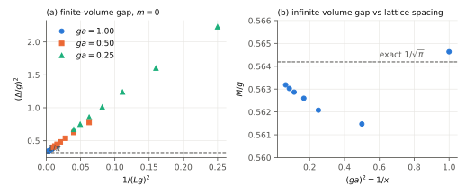
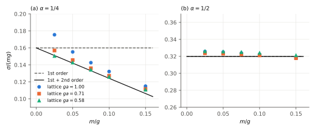
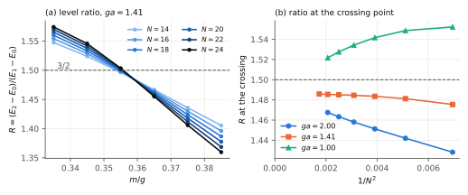
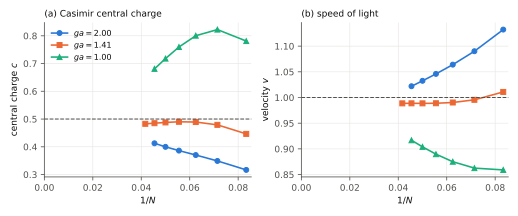
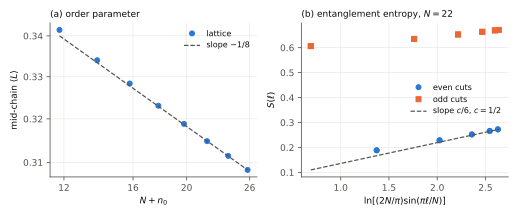
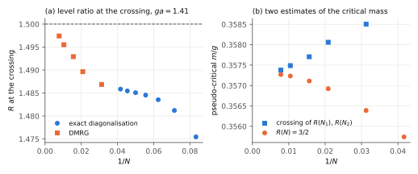

::: {.abstract}
**Abstract.** Quantum electrodynamics in 1+1 dimensions (the Schwinger model) is the simplest gauge theory that generates a mass gap from massless constituents, confines fractional charge, and — at vacuum angle $\theta=\pi$ — undergoes a quantum phase transition that has no closed-form solution. We give a self-contained derivation of the chain *anomaly → mass gap → bosonized Hamiltonian → screening versus confinement → $Z_2$ symmetry breaking → boundary conformal field theory*, and turn it into fourteen quantitative predictions. Each is tested from first principles on the gauge-invariant Kogut–Susskind lattice Hamiltonian with open boundaries, by two independent methods that agree to $10^{-11}$ where they overlap: exact diagonalisation up to 24 sites and density-matrix renormalisation group (DMRG) with an exact matrix-product form of the Coulomb interaction up to 320 sites. No physics parameter is fitted. In the continuum limit the massless gap is $M/g=0.56415$–$0.56421$ (exact: $1/\sqrt\pi=0.56419$) its slope with fermion mass is $1.7809$ ($e^\gamma=1.7811$) and its curvature $0.192$ (second-order theory: $0.191$); the string tension of fractional charges, extrapolated to the continuum, has first- and second-order coefficients $0.1593$–$0.1598$ and $-0.36$ (theory: $0.1599$, $-0.358$), and at charge $\tfrac12$ the second- and fourth-order terms vanish as required by a selection rule. We compute the third-order term of mass perturbation theory, which predicts a cubic coefficient $-0.3512$ at charge $\tfrac12$; the lattice gives $-0.348$, and the measured string tension then agrees with theory to one part in $10^4$ over the whole mass range. At the critical point the neutral sector shows the Virasoro tower of the identity (level ratios $1.498,1.993,1.995,2.487$ against $\tfrac32,2,2,\tfrac52$) and the charge $-1$ sector the $\varepsilon$ tower ($1.996,2.986,3.969,3.986$ against $2,3,4,4$); the ratio of the first two gaps at the finite-size crossing converges to $1.500(2)$ and equals $\tfrac32$ within $0.2\%$ at six lattice spacings; the central charge is $c=0.500(7)$ from the Casimir energy and $0.49(1)$ from the entanglement entropy; and $\beta/\nu=0.124(3)$, $1/\nu=1.00(1)$. We show that the even–odd alternation of the entanglement entropy on the staggered lattice is proportional to the order parameter, which explains why single-parity fits give wrong central charges and how to remove the effect. The speed of light extrapolates to $1.000(3)$ and the critical mass to $m_c/g=0.33356(9)$ in the continuum, in agreement with the tensor-network value $0.333561(4)$ of Arguello Cruz, Tarnopolsky and Xin, who established the boundary-CFT identification that we rederive and verify here. Classical and Gaussian-variational estimates of $m_c$ fail, the latter qualitatively. Nothing here bears on the four-dimensional Yang–Mills mass-gap problem beyond providing a controlled laboratory for its mechanisms.
:::

# Introduction

## The problem

The defining difficulty of quantum field theory is that its most important phenomena are invisible in perturbation theory. Quantum chromodynamics has a Lagrangian containing only massless gluons and nearly massless quarks, yet its spectrum consists of massive, colour-neutral hadrons. Proving that four-dimensional Yang–Mills theory has a mass gap is an open problem; so is deriving confinement. No expansion in the gauge coupling can produce either effect at any finite order.

Progress on such questions has historically come from models in which the mechanism can be followed from the Lagrangian to the spectrum. The most instructive is QED in one space and one time dimension, introduced by Schwinger [@schwinger] precisely to show that gauge invariance does not require a massless vector particle. In two dimensions the gauge coupling $g$ has the dimension of mass, the gauge field has no propagating degrees of freedom, and with massless fermions the model is exactly solvable [@schwinger; @lowenstein]: the spectrum is a free boson of mass $g/\sqrt\pi$. With a fermion mass $m$ and a vacuum angle $\theta$ the model is no longer solvable, and it acquires a rich structure [@cjs; @coleman76]: confinement of fractional charge, string breaking, and at $\theta=\pi$ a line of first-order transitions ending at a critical point $m_c$ in the two-dimensional Ising universality class [@hamer82; @byrnes].

## Scope and claims

This paper has three aims.

1. **Derivation.** Sections 2–4 derive, from the Lagrangian, every formula that is later tested, including the finite-size spectrum at the critical point from boundary conformal field theory (BCFT).
2. **Test.** Sections 5–7 test those formulas against exact diagonalisation and DMRG calculations for the lattice Hamiltonian. The lattice calculations use none of the continuum results as input.
3. **Honest accounting.** Section 8 separates what is confirmed, what is merely consistent, and what fails.

We state plainly what is and is not new. The physics of Sections 2–3 is classic [@schwinger; @cjs; @coleman76; @adam]. The identification of the open-chain critical spectrum with Ising boundary conditions, and its use to locate $m_c$ to five digits by tensor-network methods, is due to Arguello Cruz, Tarnopolsky and Xin [@act]; we arrived at the same identification independently by the physical argument of Section 4 before consulting that work, and our numerical results agree with theirs where they overlap. What this paper adds is (i) a verification with independently written exact-diagonalisation and DMRG codes, including the degeneracy structure of two conformal towers; (ii) a measurement of the central charge, which Ref. [@act] takes as input, by two routes — the Casimir energy, bounded from both sides, and the entanglement entropy; (iii) the observation that the alternating part of the entanglement entropy on the staggered lattice is proportional to the order parameter, and a parity-averaged estimator that removes it; (iv) the third-order term of mass perturbation theory for the vacuum energy and string tension, and lattice tests of the second and third orders; and (v) an explicit demonstration that the Gaussian variational method predicts the wrong order for the transition. We make no claim about four-dimensional gauge theory.

# The continuum theory

## Lagrangian and conventions

We use metric $(+,-)$, $\epsilon^{01}=+1$, $\gamma^5=\gamma^0\gamma^1$, and

$$\mathcal L = -\tfrac14 F_{\mu\nu}F^{\mu\nu} + \bar\psi\left(i\gamma^\mu\partial_\mu - g\gamma^\mu A_\mu - m\right)\psi - \frac{g\theta}{4\pi}\,\epsilon^{\mu\nu}F_{\mu\nu}. \qquad (2.1)$$

The electric field is $E\equiv F_{01}$, so $F^{\mu\nu}=-\epsilon^{\mu\nu}E$ and the last term is $(g\theta/2\pi)E$, a total derivative. The parameters are $m/g$ and $\theta$; the theory is super-renormalisable and $g$ sets the scale.

In the gauge $A_1=0$ the field $A_0$ is not dynamical. Its equation of motion is Gauss's law,

$$\partial_1 E = g\,j^0, \qquad j^\mu=\bar\psi\gamma^\mu\psi, \qquad (2.2)$$

whose solution is $E(x)=g\int^x j^0 + F$. The integration constant $F$ is a background field. Coleman [@coleman76] showed that it is the same thing as the vacuum angle, $F=g\theta/2\pi$, and that physics is periodic in $\theta$ with period $2\pi$: a background field larger than $g/2$ in magnitude is lowered by pair production. Equivalently, static external charges $\pm\alpha g$ placed at the ends of the system shift $\theta\to\theta+2\pi\alpha$ between them. The Hamiltonian is

$$H=\int dx\left[\bar\psi\left(-i\gamma^1\partial_1+m\right)\psi+\tfrac12E^2\right]. \qquad (2.3)$$

Eliminating $E$ gives a linear potential $-\tfrac{g^2}{4}\int\!\!\int j^0(x)\,|x-y|\,j^0(y)$ between charges. Classically, then, all charge is confined. Quantum mechanically the answer is subtler, and depends on $m$.

## The anomaly generates the mass gap

Set $m=0$. Classically both the vector current $j^\mu$ and the axial current $j_5^\mu=\bar\psi\gamma^\mu\gamma^5\psi$ are conserved. In two dimensions they are not independent: $\gamma^\mu\gamma^5=-\epsilon^{\mu\nu}\gamma_\nu$, so

$$j_5^\mu=-\epsilon^{\mu\nu}j_\nu. \qquad (2.4)$$

Quantum mechanically, gauge invariance forces the axial current to be anomalous,

$$\partial_\mu j_5^\mu=\frac{g}{\pi}E. \qquad (2.5)$$

(The overall sign depends on conventions for $\epsilon$ and $\gamma^5$; the sign relative to the coupling in Eq. (2.1) is fixed, and is the one that makes Eq. (2.7) non-tachyonic.) Maxwell's equation $\partial_\mu F^{\mu\nu}=g j^\nu$ reads $-\epsilon^{\mu\nu}\partial_\mu E=g j^\nu$. Taking the divergence of Eq. (2.4) and using $\epsilon^{\mu\nu}\epsilon_{\lambda\nu}=-\delta^\mu_\lambda$,

$$\partial_\mu j_5^\mu=-\epsilon^{\mu\nu}\partial_\mu j_\nu=-\frac1g\,\Box E. \qquad (2.6)$$

Equating Eqs. (2.5) and (2.6),

$$\left(\Box+\frac{g^2}{\pi}\right)E=0. \qquad (2.7)$$

The electric field is a free massive field. Since every gauge-invariant local operator of the massless model can be built from $E$, the entire spectrum is a free boson of mass

$$M_0=\frac{g}{\sqrt\pi}\approx0.56419\,g. \qquad (2.8)$$

No massless particle survives: the photon has absorbed the fermion–antifermion pair. Three features of this derivation are special to two dimensions and should be kept in mind when drawing analogies: the identity (2.4); the absence of transverse photons; and the fact that Eqs. (2.5)–(2.6) close on a single field.

## Bosonization

The same result follows, together with much more, from abelian bosonization [@coleman75; @mandelstam]. A Dirac fermion in 1+1 dimensions is equivalent to a real scalar $\phi$ with the dictionary

$$j^\mu=\frac{1}{\sqrt\pi}\epsilon^{\mu\nu}\partial_\nu\phi,\qquad \bar\psi\, i\gamma^\mu\partial_\mu\psi\to\tfrac12(\partial\phi)^2,\qquad \bar\psi\psi=-\frac{e^{\gamma}}{2\pi}\,\mu\,N_\mu\!\left[\cos 2\sqrt\pi\phi\right], \qquad (2.9)$$

where $\gamma=0.5772\ldots$ is Euler's constant and $N_\mu$ denotes normal ordering with respect to a free field of mass $\mu$. The vector current is identically conserved, and Gauss's law (2.2) integrates to

$$E=\frac{g}{\sqrt\pi}\phi+\frac{g\theta}{2\pi}=\frac{g}{\sqrt\pi}\left(\phi+\frac{\theta}{2\sqrt\pi}\right). \qquad (2.10)$$

Substituting into Eq. (2.3) and choosing $\mu=M_0$,

$$H=\int dx\;N_{M_0}\!\left[\tfrac12\Pi^2+\tfrac12(\partial_x\phi)^2+\frac{M_0^2}{2}\left(\phi+\frac{\theta}{2\sqrt\pi}\right)^2-c\,m g\cos\left(2\sqrt\pi\phi\right)\right], \qquad (2.11)$$

with $c=e^\gamma/2\pi^{3/2}\approx0.15993$.

Shifting $\phi\to\phi-\theta/2\sqrt\pi$ moves $\theta$ into the cosine:

$$V(\phi)=\frac{g^2}{2\pi}\phi^2-c\,m g\cos\left(2\sqrt\pi\phi-\theta\right). \qquad (2.12)$$

At $m=0$ this is a free field of mass $M_0$, reproducing Eq. (2.8), and $\theta$ has disappeared entirely.

## Screening, confinement and mass perturbation theory

The vacuum energy density $\mathcal E(\theta)$ controls the force between external charges $\pm\alpha g$ a distance $r$ apart: for large $r$ the energy cost is $\sigma r$ with string tension

$$\sigma(\alpha)=\mathcal E(\theta+2\pi\alpha)-\mathcal E(\theta). \qquad (2.13)$$

**Massless case.** $\mathcal E$ is independent of $\theta$, so $\sigma=0$ for every $\alpha$. Classical confinement is completely undone: the vacuum polarises and screens any charge. This is the same physics as the mass gap, seen from another side — a massive photon mediates a short-range force.

**Massive case.** To first order in $m$ the energy shift is the expectation value of the perturbation in the free vacuum, and $\langle N_{M_0}\cos(2\sqrt\pi\phi-\theta)\rangle_0=\cos\theta$, so $\mathcal E^{(1)}=-c\,mg\cos\theta$. The second-order term was computed by Adam [@adam]. In his notation $\Sigma=e^\gamma M_0/2\pi=c\,g$ and

$$\mathcal E(\theta)=-m\Sigma\cos\theta-\frac{m^2\Sigma^2}{4M_0^2}\left(\mathcal A_+\cos2\theta+\mathcal A_-\right)+O(m^3), \qquad (2.14)$$

with $\mathcal A_+=-8.9139$, $\mathcal A_-=9.7384$, where $\mathcal A_\pm=M_0^2\int d^2x\,(e^{\mp2K_0(M_0|x|)}-1)$. (Ref. [@adam] quotes $\epsilon=\ln Z/V$, which is minus the energy density; the sign in Eq. (2.14) is such that the $\theta$-averaged second-order energy is negative, as it must be.) Hence, at $\theta=0$,

$$\frac{\sigma(\alpha)}{g^2}=c\,\frac mg\left(1-\cos2\pi\alpha\right)+b(\alpha)\left(\frac mg\right)^2+\ldots,\qquad b(\alpha)=\frac{e^{2\gamma}}{16\pi^2}\,\mathcal A_+\left(1-\cos4\pi\alpha\right). \qquad (2.15)$$

Numerically $b(\tfrac14)=-0.358$ and $b(\tfrac12)=0$.

**Third order.** We have extended the calculation of the vacuum energy to third order (Appendix B). The third cumulant of the mass operator gives

$$\mathcal E^{(3)}(\theta)=-\frac{m^3\Sigma^3}{48M_0^4}\left[2I_3\cos3\theta+6I_1\cos\theta\right],\qquad I_3=220.798,\quad I_1=-108.395(1), \qquad (2.19)$$

where $I_3$ and $I_1$ are convergent four-dimensional integrals of products of $e^{\pm2K_0}$, evaluated numerically. The third-order coefficient of the string tension, defined by $\sigma/(mg)=a+b\,(m/g)+c_3(m/g)^2+c_4(m/g)^3+\ldots$, is therefore

$$c_3(\alpha)=\frac{e^{3\gamma}}{384\,\pi^{5/2}}\left[2I_3\left(1-\cos6\pi\alpha\right)+6I_1\left(1-\cos2\pi\alpha\right)\right], \qquad (2.20)$$

so that $c_3(\tfrac12)=-0.3512$ and $c_3(\tfrac14)=-0.1756$.

**A selection rule.** At order $n$ in $m$ the vacuum energy contains only the harmonics $\cos k\theta$ with $k\equiv n\pmod 2$, because each insertion of the mass operator carries $e^{\pm i\theta}$. For $\alpha=\tfrac12$ the string tension is $\mathcal E(\pi)-\mathcal E(0)$, to which even harmonics do not contribute. Hence **all even orders vanish at $\alpha=\tfrac12$**: $b(\tfrac12)=0$, $c_4(\tfrac12)=0$, and so on. We recomputed $\mathcal A_+$ by direct quadrature and reproduce $-8.9139$ (`check_formulas.py`). Fractional charges are confined by a linear potential; integer charges ($\alpha\in\mathbb Z$) are not, because a dynamical fermion pair breaks the string. Expanding the cosine in Eq. (2.12) about its minimum gives the boson mass

$$M^2=M_0^2+4\pi c\,mg\cos\theta+O(m^2)\quad\Longrightarrow\quad \frac{dM}{dm}\Big|_{m=0,\theta=0}=e^\gamma\approx1.7811. \qquad (2.16)$$

To second order Adam [@adam] finds, with $t=m/M_0$,

$$\frac{M^2}{M_0^2}=1+3.5621\,t\cos\theta+5.4807\,t^2-2.0933\,t^2\cos2\theta+O(t^3), \qquad (2.17)$$

where $3.5621=2e^\gamma$. At $\theta=0$ this gives $M=M_0+e^\gamma m+0.1076\,m^2/M_0+\ldots$, that is

$$\frac12\frac{d^2M}{dm^2}\Big|_{m=0,\theta=0}=\frac{0.1907}{g}. \qquad (2.18)$$

# The point θ = π

## Symmetry breaking

At $\theta=\pi$ Eq. (2.12) becomes

$$V(\phi)=\frac{g^2}{2\pi}\phi^2+c\,mg\cos2\sqrt\pi\phi, \qquad (3.1)$$

which is even in $\phi$. The symmetry $\phi\to-\phi$ is charge conjugation, which maps $E\to-E$ and is a symmetry only when the background field is $0$ or $g/2$. For small $m$ the parabola dominates, the vacuum is unique and $\langle E\rangle=0$ in the shifted variable — that is, the fermions half-screen the background field. For large $m$ the cosine dominates and there are two degenerate vacua near $\phi=\pm\sqrt\pi/2$, with electric field $\pm g/2$: these are the classical states "background field unscreened" and "background field reversed by one pair". Charge conjugation is spontaneously broken. One real scalar field with a $Z_2$ symmetry interpolating between a single and a double well is the Landau–Ginzburg description of the two-dimensional Ising model, so if the transition is continuous it must be in the Ising universality class, with central charge $c=\tfrac12$ and exponents $\nu=1$, $\beta=\tfrac18$ [@coleman76; @hamer82; @byrnes]. The order parameter is the electric field.

## Analytic estimates of the critical mass

**Classical.** The curvature of Eq. (3.1) at the origin vanishes at

$$\frac{m_c}{g}\Big|_{\mathrm{cl}}=\frac{1}{4\pi^2c}=\frac{1}{2\sqrt\pi\,e^{\gamma}}\approx0.1584. \qquad (3.2)$$

This is identical to the point where the first-order mass formula (2.16) gives $M^2=0$, as it must be, since both keep one power of the normal-ordered cosine.

**Second-order mass perturbation theory.** One might hope that Eq. (2.17) improves on this. At $\theta=\pi$ it reads $M^2/M_0^2=1-3.5621\,t+3.3874\,t^2$, whose discriminant is negative: the second-order mass never vanishes (its minimum, $0.064\,M_0^2$, is at $m/g=0.297$). Truncated mass perturbation theory therefore does not locate the transition at all, although the position of its minimum is suggestive.

**Gaussian variational.** The classical estimate ignores the fact that the cosine is normal-ordered with respect to mass $M_0$, while near the transition the fluctuating field is much lighter. A Gaussian trial state with mean $\phi_0$ and mass $\mu$ accounts for this [@stevenson]. Using Coleman's re-ordering identities [@coleman75],

$$\begin{aligned}N_{M}\!\left[\tfrac12\Pi^2+\tfrac12\phi'^2\right]&=N_\mu\!\left[\tfrac12\Pi^2+\tfrac12\phi'^2\right]+\frac{\mu^2-M^2}{8\pi},\qquad N_M[\phi^2]=N_\mu[\phi^2]+\frac{1}{4\pi}\ln\frac{M^2}{\mu^2},\\ N_M[\cos\beta\phi]&=\left(\frac{\mu}{M}\right)^{\beta^2/4\pi}N_\mu[\cos\beta\phi],\end{aligned} \qquad (3.3)$$

with $\beta^2=4\pi$, the energy density of the trial state in units of $M_0^2$ is

$$\frac{\mathcal E(\mu,\phi_0)}{M_0^2}=\frac{\mu^2-1}{8\pi}-\frac{\ln\mu^2}{8\pi}+\frac{\phi_0^2}{2}+k\,\mu\cos2\sqrt\pi\phi_0,\qquad k=\pi c\,\frac mg, \qquad (3.4)$$

where $\mu$ is measured in units of $M_0$. Stationarity in $\mu$ gives $\mu=\tfrac12\left(-a+\sqrt{a^2+4}\right)$ with $a=4\pi k\cos2\sqrt\pi\phi_0$. A continuous transition would require the curvature in $\phi_0$ at the origin to vanish, $1=4\pi k\mu$, simultaneously with the gap equation at $\phi_0=0$, $\mu-1/\mu+4\pi k=0$. Eliminating $k$ gives $1/\mu=0$: **there is no solution**. The Gaussian approximation therefore cannot produce a continuous transition here. Minimising Eq. (3.4) numerically (Fig. 1b) one finds instead that a pair of minima at $\phi_0\approx\pm0.63$ drops below the symmetric minimum at

$$\frac{m_c}{g}\Big|_{\mathrm{Gauss}}\approx0.265\quad\text{(first order)}. \qquad (3.5)$$

Both estimates are tested, and found wanting, in Section 7.

{width=100%}

# Finite-size spectrum at criticality from boundary CFT

The lattice calculation works on an interval of length $L$, so we need the prediction for the spectrum in a finite box with definite boundary conditions. For a conformal field theory on a strip with boundary conditions $a$, $b$, Cardy [@cardy86; @cardy89] showed that the Hamiltonian is

$$H_{ab}=e_\infty L+e_a+e_b+\frac{\pi v}{L}\left(L_0-\frac{c}{24}\right), \qquad (4.1)$$

with $e_\infty$, $e_{a,b}$ non-universal bulk and boundary energies, $v$ the velocity, and $L_0$ acting on a direct sum of irreducible Virasoro representations determined by the pair $(a,b)$. The partition function is a sum of characters, $Z_{ab}=\sum_i n^i_{ab}\chi_i(q)$, $q=e^{-\pi v/LT}$. The Casimir term $-\pi cv/24L$ is the Blöte–Cardy–Nightingale–Affleck result [@bcn; @affleck].

For the Ising model ($c=\tfrac12$) there are three conformal boundary conditions — spin fixed up ($+$), fixed down ($-$), and free ($f$) — and

$$Z_{++}=\chi_0,\qquad Z_{+-}=\chi_{1/2},\qquad Z_{ff}=\chi_0+\chi_{1/2},\qquad Z_{+f}=\chi_{1/16}, \qquad (4.2)$$

$$\begin{aligned}\chi_0&=q^{-1/48}\left(1+q^2+q^3+2q^4+2q^5+3q^6+\ldots\right),\\ \chi_{1/2}&=q^{1/2-1/48}\left(1+q+q^2+q^3+2q^4+2q^5+\ldots\right).\end{aligned} \qquad (4.3)$$

**Which boundary condition does the gauge theory realise?** Consider the Schwinger model on an interval with the background field $g/2$ entering at the left wall, and total charge $Q$ on the interval, so that the field leaving at the right wall is $g(\tfrac12+Q)$. In the ordered phase the two bulk vacua have field $+g/2$ and $-g/2$.

- $Q=0$: the field is $+g/2$ at both walls. The vacuum $+g/2$ matches both walls at no cost. The vacuum $-g/2$ requires a unit charge at each wall, costing $\approx2m$. Both walls therefore act as a boundary magnetic field of the same sign on the Ising order parameter. Under the renormalisation group a boundary field flows to the fixed boundary condition, so the critical theory has boundary conditions $(+,+)$.
- $Q=-1$: the field is $+g/2$ on the left and $-g/2$ on the right. The walls favour opposite vacua: $(+,-)$.
- $Q=+1$: the field leaving is $3g/2$, which is not a vacuum. The extra charge binds to the right wall at an $O(g)$ energy cost, after which the bulk again sees $(+,+)$.

From Eqs. (4.1)–(4.3), the predictions at $m=m_c$ are parameter-free:

$$Q=0:\quad \frac{E_n-E_0}{E_1-E_0}=1,\;\tfrac32,\;2,\;2,\;\tfrac52,\ldots\qquad\qquad Q=-1:\quad \frac{E_n-E_0}{E_1-E_0}=1,\;2,\;3,\;4,\;4,\ldots \qquad (4.4)$$

$$E_1-E_0=\frac{2\pi v}{L+\ell},\qquad E_0=e_\infty L+2e_b-\frac{\pi c\,v}{24(L+\ell)}\qquad(Q=0). \qquad (4.5)$$

Here $\ell$ is an extrapolation length. It arises because the leading irrelevant boundary operator for a fixed boundary is the stress tensor, whose effect at first order is to rescale all levels by a common factor $1-\ell/L$; ratios are therefore corrected only at relative order $L^{-2}$. Eliminating $v$ and $\ell$ between the two relations (4.5) gives

$$E_0=e_\infty L+2e_b-\frac{c}{48}\left(E_1-E_0\right), \qquad (4.6)$$

an estimator of $c$ that needs neither. By contrast, free boundaries would give $(E_2-E_0)/(E_1-E_0)=3$.

The identification (4.4) of the $Q=0$ and $Q=\pm1$ sectors with $(+,+)$ and $(+,-)$ was made, and used as a criterion to locate $m_c$, in Ref. [@act].

**Further Ising predictions.** With $(+,+)$ boundaries the order parameter profile at criticality is $\langle\sigma(x)\rangle\propto[(L/\pi)\sin(\pi x/L)]^{-1/8}$, so the mid-chain electric field scales as

$$\langle E\rangle_{\mathrm{mid}}\propto(L+\ell)^{-\beta/\nu},\qquad\beta/\nu=\tfrac18, \qquad (4.7)$$

and the entanglement entropy of a block of length $x$ adjacent to a wall is [@cc]

$$S(x)=\frac c6\ln\left[\frac{2L}{\pi}\sin\frac{\pi x}{L}\right]+\text{const}. \qquad (4.8)$$

Near the critical point any dimensionless ratio is a function of $(m-m_c)L^{1/\nu}$ with $\nu=1$.

## Summary of predictions

| | Prediction | Value | Source |
|---|---|---|---|
| P1 | massless gap $M_0/g$ | $0.56419$ | Eq. (2.8) |
| P2 | $dM/dm$ at $m=0$ | $1.7811$ | Eq. (2.16) |
| P2′ | $\tfrac12d^2M/dm^2$ at $m=0$ | $0.1907/g$ | Eq. (2.18) |
| P3 | string tension at $m=0$ | $0$ for all $\alpha$ | Sec. 2.4 |
| P4 | $\sigma$, linear coefficient | $0.15993\,(1-\cos2\pi\alpha)$ | Eq. (2.15) |
| P5 | $\sigma$, quadratic coefficient | $-0.358$ ($\alpha=\tfrac14$), $0$ ($\alpha=\tfrac12$) | Eq. (2.15) |
| P5′ | $\sigma$, cubic coefficient; even orders at $\alpha=\tfrac12$ | $-0.3512$ ($\alpha=\tfrac12$), $-0.1756$ ($\alpha=\tfrac14$); $c_4(\tfrac12)=0$ | Eq. (2.20) |
| P6 | critical point exists at $\theta=\pi$, gap $\propto1/L$ | — | Sec. 3.1 |
| P7 | $Q=0$ level ratios | $\tfrac32,2,2,\tfrac52$ | Eq. (4.4) |
| P8 | $Q=-1$ level ratios | $2,3,4,4$ | Eq. (4.4) |
| P9 | central charge | $\tfrac12$ | Eq. (4.6) |
| P10 | $\beta/\nu$ | $\tfrac18$ | Eq. (4.7) |
| P11 | $\nu$ | $1$ | Sec. 4 |
| P12 | $v\to1$ in the continuum limit | $1$ | Lorentz invariance |

# Lattice formulation

## Hamiltonian

We use the Kogut–Susskind Hamiltonian [@ks; @bsk] with one-component staggered fermions $\chi_n$ on sites $n=1,\ldots,N$ (spacing $a$) and link variables $U_n=e^{i\vartheta_n}$ with conjugate integer-spaced electric fields $L_n$, $[\vartheta_n,L_m]=i\delta_{nm}$:

$$H=-\frac{i}{2a}\sum_{n=1}^{N-1}\left(\chi_n^\dagger U_n\chi_{n+1}-\text{h.c.}\right)+m_{\mathrm{lat}}\sum_{n=1}^N(-1)^n\chi_n^\dagger\chi_n+\frac{g^2a}{2}\sum_{n=1}^{N-1}L_n^2. \qquad (5.1)$$

Even sites carry the upper (particle) component and odd sites the lower (antiparticle) component, so an occupied even site has charge $+1$ and an empty odd site charge $-1$. Gauss's law is

$$L_n-L_{n-1}=\chi_n^\dagger\chi_n-\tfrac12\left[1-(-1)^n\right]. \qquad (5.2)$$

With open boundaries and $L_0=\varepsilon_0\equiv\theta/2\pi$ fixed, Eq. (5.2) determines every $L_n$ in terms of the fermion occupations, and the link phases can be removed by the gauge transformation $\chi_n\to\prod_{k<n}U_k^\dagger\chi_n$. The gauge field is thereby eliminated exactly; what remains is its Coulomb interaction. A Jordan–Wigner transformation $\chi_n=\prod_{k<n}(i\sigma^z_k)\,\sigma^-_n$ gives a spin chain. In units $W=2H/(ag^2)$,

$$W=x\sum_{n=1}^{N-1}\left(\sigma^+_n\sigma^-_{n+1}+\text{h.c.}\right)+\frac{\mu}{2}\sum_{n=1}^{N}\left[1+(-1)^n\sigma^z_n\right]+\sum_{n=1}^{N-1}L_n^2, \qquad (5.3)$$

$$L_n=\varepsilon_0+\frac12\sum_{k=1}^{n}\left[\sigma^z_k+(-1)^k\right],\qquad x=\frac{1}{g^2a^2},\qquad\mu=\frac{2m_{\mathrm{lat}}}{g^2a}=2\sqrt x\,\frac{m_{\mathrm{lat}}}{g}. \qquad (5.4)$$

Energies in units of $g$ are $W/2\sqrt x$; the physical length is $Lg=N/\sqrt x$; the total charge is $Q=\tfrac12\sum_n\sigma^z_n$ (for even $N$) and is conserved. The continuum limit is $x\to\infty$ at fixed $N/\sqrt x\to\infty$. The term $\sum L_n^2$ is a long-range (linear) interaction between all pairs of spins — the lattice form of the Coulomb potential of Section 2.1.

## Mass shift

Dempsey, Klebanov, Pufu and Zan [@dkpz] observed that at $m_{\mathrm{lat}}=0$ the lattice Hamiltonian is not at the point corresponding to the massless continuum theory: the lattice remnant of the discrete chiral symmetry — translation by one site accompanied by a shift of $\theta$ by $\pi$ — is a symmetry only if

$$m_{\mathrm{lat}}=m-\frac{g^2a}{8}\qquad\Longleftrightarrow\qquad\mu=2\sqrt x\,\frac mg-\frac14. \qquad (5.5)$$

With this identification lattice artefacts start at $O(a^2)$ rather than $O(a)$. We use Eq. (5.5) throughout; $m$ always denotes the physical mass.

# Numerical method

**Basis.** For even $N$ and charge $Q$ the basis consists of all bit strings with $N/2+Q$ up spins; the dimension is $\binom{N}{N/2+Q}$, which is $705\,432$ at $N=22$ and $2\,704\,156$ at $N=24$ for $Q=0$. The diagonal of $W$ (mass and electric energy) is computed once per size as three vectors, since $\sum_nL_n^2=\sum_nc_n^2+2\varepsilon_0\sum_nc_n+(N-1)\varepsilon_0^2$ with $c_n=L_n-\varepsilon_0$, so that changing $m$, $x$ or $\varepsilon_0$ costs nothing.

**Matrix–vector product.** The hopping term connects each basis state to at most $N-1$ others. Their indices are tabulated once (binary search in the sorted basis) and the product is evaluated by an OpenMP-parallel C kernel (`kernel.c`, 12 lines).

**Eigensolver.** Lanczos iteration with full (twice-applied) Gram–Schmidt reorthogonalisation against all previous vectors. Full reorthogonalisation removes ghost eigenvalues, which matters here because we need several low-lying levels and exact degeneracies are part of the prediction. Iteration stops when the lowest $k$ Ritz values change by less than $10^{-10}$ (relative) over ten steps. Memory for the Lanczos basis is the binding constraint and limits us to $N\le24$.

**Validation.** The code is checked (`test_qed2.py`) against an independent dense Hamiltonian built from Kronecker products of Pauli matrices in the full $2^N$-dimensional space and then restricted to $Q=0$; the four lowest levels agree to $10^{-9}$ for three parameter sets including $\varepsilon_0\ne0$.

**Infinite-volume gap away from criticality.** In a massive phase the first excited state is a single boson in a box, with $\Delta^2=M^2+\pi^2v^2/(L+\ell)^2$. We fit $\Delta^2=M^2+C/(N+n_0)^2$ to sizes $N=12,\ldots,22$ with $M$, $C$, $n_0$ free.

**String tension.** $\sigma$ is the difference of bulk energy densities with and without background field. The bulk density is taken from $[E_0(N_2)-E_0(N_1)]/(L_2-L_1)$, which cancels boundary energies exactly and leaves corrections of order $e^{-ML}$. Because $\sigma\equiv0$ at $m=0$, the measured value there is a direct diagnostic of the residual finite-volume error; we keep only volumes $Lg\ge11$, for which it is below $10^{-3}g^2$.

**Critical point.** The ratio $R=(E_2-E_0)/(E_1-E_0)$ is computed on a grid of six masses spaced by $0.01g$ and interpolated by a cubic. The pseudo-critical mass $m_c(N)$ is defined as the crossing of $R(m;N-2)$ and $R(m;N)$; near $m_c$ the ratio depends on $m$ and $N$ only through $(m-m_c)N^{1/\nu}$, so curves for different sizes cross at $m_c$ up to corrections from irrelevant operators. The central charge then follows from Eq. (4.6) by taking second differences in $N$, which remove the terms linear in $L$:

$$c=-48\,\frac{E_0(N)-2E_0(N-2)+E_0(N-4)}{\Delta(N)-2\Delta(N-2)+\Delta(N-4)},\qquad v=\left[2\pi\,\frac{1/\Delta(N)-1/\Delta(N-2)}{L(N)-L(N-2)}\right]^{-1}, \qquad (6.1)$$

with $\Delta=E_1-E_0$. Both are evaluated at $m_c(N)$.

**Density-matrix renormalisation group.** Exact diagonalisation stops at $N=24$. To reach the sizes that the critical point requires we use two-site DMRG on the same Hamiltonian (`dmrg.py`). The only non-trivial ingredient is the Coulomb term, which couples all pairs of sites. Writing $q_k=\tfrac12[\sigma^z_k+(-1)^k]$ for the charge on site $k$, so that $L_n=\varepsilon_0+\sum_{k\le n}q_k$,

$$\sum_{n=1}^{N-1}L_n^2=\sum_{k=1}^{N}(N-k)\left(q_k^2+2\varepsilon_0q_k\right)+2\sum_{j<k}(N-k)\,q_jq_k+(N-1)\varepsilon_0^2. \qquad (6.2)$$

A pair interaction whose strength depends only on the position of the right-hand site is generated exactly by a matrix-product operator in which the left-hand charge is carried along a single auxiliary channel. Adding a penalty $\lambda(Q-Q_0)^2$, $Q=\sum_ks_k$, $s_k=\tfrac12\sigma^z_k$, to select the charge sector costs one more channel. The complete Hamiltonian is the product of the operator-valued matrices

$$\mathcal W_k=\begin{pmatrix}1&q_k&s_k&\sigma^+_k&\sigma^-_k&h_k\\0&1&0&0&0&2(N-k)\,q_k\\0&0&1&0&0&2\lambda\,s_k\\0&0&0&0&0&x\,\sigma^-_k\\0&0&0&0&0&x\,\sigma^+_k\\0&0&0&0&0&1\end{pmatrix}, \qquad (6.3)$$

$$h_k=\frac\mu2\left[1+(-1)^k\sigma^z_k\right]+(N-k)\left(q_k^2+2\varepsilon_0q_k\right)+\lambda\left(\tfrac14-2Q_0s_k\right)+\text{const}, \qquad (6.4)$$

contracted with the first row on the left and the last column on the right. The bond dimension is 6 for any $N$; no truncation of the interaction range is made. We use $\lambda=4$ (in units of $W$), which lifts all other charge sectors far above the levels of interest. Excited states are found by adding $w\sum_j|\psi_j\rangle\langle\psi_j|$, $w=20$, for the states already obtained. Each two-site problem is solved by Lanczos iteration; singular values are discarded up to a total weight of $10^{-13}$, with a cap $\chi\le120$ that is never reached (the largest bond dimension used is $80$, for the second excited state at $N=128$); sweeps continue until the energy changes by less than $10^{-10}$ in two successive sweeps.

*Validation and accuracy.* The DMRG code reproduces the exact-diagonalisation energies of the three lowest states to $2\times10^{-11}$ for four parameter sets, including $Q=-1$ and $\varepsilon_0\ne0$ (`test_dmrg.py`), and the electric-field profile and entanglement entropies to $10^{-6}$. For the slowest case ($N=128$) we continued the ground-state run to 33 sweeps: the energy moved by $3\times10^{-10}g$ relative to the production value. Repeating it with a deliberately crude truncation ($\chi\le40$, discarded weight $10^{-11}$) shifts the energy by $1.2\times10^{-8}g$ (`check_dmrg_convergence.py`). The gaps at that size are $0.03$–$0.05\,g$ and the Casimir second differences are of order $10^{-6}g$, so the DMRG error is negligible in everything that follows.

All scripts and raw numbers are in the repository; Appendix C lists them.

# Results

## Mass gap of the massless model (P1, P2)

Figure 2(a) shows the gap at $m=0$ for three lattice spacings. Plotted as $\Delta^2$ against $1/L^2$ the data collapse onto a straight line with intercept $1/\pi$, as expected for a free boson in a box. Table 1 and Fig. 2(b) give the infinite-volume gap. For $x\ge2$ it approaches the exact value monotonically from below, but at the finest spacings the exact-diagonalisation volumes are small ($Lg=5.5$ at $x=16$) and the three-parameter finite-size fit carries most of the weight. DMRG removes this limitation: with $N=40,56,72$ the three unknowns $M$, $C$, $n_0$ are solved for exactly at volumes $Lg=14$–$36$ (Table 2). A linear extrapolation in $a^2$ of the three finest spacings, and a quadratic one through all four, give

$$\frac{M_0}{g}=0.56415\quad\text{and}\quad0.56421,\qquad\text{exact: }0.56419,$$

an agreement of one part in $10^4$. The value at $x=1$ in Table 1 lies slightly above the trend, an indication that at $ga=1$ higher-order lattice artefacts are not negligible.

| $x$ | 1 | 2 | 4 | 6 | 9 | 12 | 16 |
|---|---|---|---|---|---|---|---|
| $ga$ | 1.00 | 0.71 | 0.50 | 0.41 | 0.33 | 0.29 | 0.25 |
| $Lg$ at $N=22$ | 22.0 | 15.6 | 11.0 | 9.0 | 7.3 | 6.4 | 5.5 |
| $M_0/g$ | 0.56463 | 0.56147 | 0.56208 | 0.56260 | 0.56287 | 0.56303 | 0.56318 |

: Infinite-volume gap of the massless model from exact diagonalisation, $N=12$–$22$.

| $x$ | 4 | 9 | 16 | 25 |
|---|---|---|---|---|
| $ga$ | 0.50 | 0.33 | 0.25 | 0.20 |
| $Lg$ at $N=72$ | 36.0 | 24.0 | 18.0 | 14.4 |
| $M_0/g$ | 0.56205 | 0.56307 | 0.56353 | 0.56376 |

: Infinite-volume gap of the massless model from DMRG, $N=40,56,72$.

{width=100%}

**Slope and curvature (P2).** For the dependence on the fermion mass we repeat the infinite-volume fit at $m/g=0$, $0.005$, $0.01$, $0.02$, $0.03$, $0.04$ and fit $M(m)$ by a cubic. Here the volume matters more than at $m=0$, because the box formula is exact only for the free boson. Table 3 shows the slope from three consecutive sizes as the largest volume grows.

| $x$ | $N$ | $Lg_{\max}$ | $dM/dm$ | $\tfrac12d^2M/dm^2$ |
|---|---|---|---|---|
| 9 | 40, 56, 72 | 24 | 1.7740 | $+0.200$ |
| 9 | 56, 72, 96 | 32 | 1.7746 | $+0.190$ |
| 9 | 72, 96, 128 | 43 | 1.7746 | $+0.189$ |
| 16 | 40, 56, 72 | 18 | 1.7743 | $+0.206$ |
| 16 | 56, 72, 96 | 24 | 1.7768 | $+0.201$ |
| 16 | 72, 96, 128 | 32 | 1.7774 | $+0.191$ |
| $a\to0$, $Lg_{\max}=24$ | | | 1.7804 | $+0.202$ |
| $a\to0$, $Lg_{\max}=32$ | | | 1.7809 | $+0.192$ |
| theory | | | 1.7811 | $+0.191$ |

: Slope and curvature of the boson mass at $m=0$ from DMRG (cubic fit to six masses), and their extrapolation linear in $a^2$ at matched physical volume.

At $x=9$ the slope is converged in volume ($1.7746$ at both $Lg_{\max}=32$ and $43$); at $x=16$ it still rises by $0.0006$ between $Lg_{\max}=24$ and $32$. Extrapolating the two spacings linearly in $a^2$ at equal volume gives

$$\frac{dM}{dm}\Big|_{m=0}=1.7804\;\;(Lg_{\max}=24),\qquad1.7809\;\;(Lg_{\max}=32),\qquad\text{exact: }e^\gamma=1.7811,$$

an agreement of $0.01$–$0.04\%$. Two cautionary remarks. First, with a fixed set of chain lengths the physical volume shrinks as the lattice is refined, and the resulting negative finite-volume bias nearly cancels the positive lattice-spacing trend: with $N=40,56,72$ at every spacing the slope is $1.774$–$1.776$ for $x=9,16,25$, an apparent plateau $0.3\%$ below the exact value. (Exact diagonalisation gives $1.753$ at $x=2$, $1.798$ at $x=4$, and $1.874$ at $x=9$ where $Lg\le6.7$; the last is the same volume effect in a more extreme form.) Second, more masses do not change the answer: a two-point estimate from $m/g=0.02$ and $0.04$ agrees with the six-point cubic fit to $0.0004$. The curvature extrapolates to $+0.192$ ($Lg_{\max}=32$) and $+0.202$ ($Lg_{\max}=24$), against $0.1907$ from Eq. (2.18): the second-order mass formula is confirmed to $1\%$ at the larger volume.

## Screening and confinement (P3–P5)

Table 4 and Fig. 3 show the string tension. At $m=0$ the measured $\sigma$ is zero within the finite-volume diagnostic: $|\sigma|/g^2\le1\times10^{-4}$ for $\alpha=\tfrac14$ at $x=2,3$ and below $10^{-5}$ for $\alpha=\tfrac12$. Charge is screened.

For $m>0$ the string tension is non-zero and, for $\alpha=\tfrac12$, linear in $m$ with slope within $2\%$ of $2c$. For $\alpha=\tfrac14$ the first-order formula overestimates $\sigma$ by $12\%$ at $m/g=0.05$ and $27\%$ at $m/g=0.1$. The second-order term of Eq. (2.15) accounts for this: with it, lattice and theory agree to between $0.4\%$ and $1.4\%$ for $m/g\le0.1$ at $x=3$. A straight-line fit of $\sigma/m$ against $m$ gives an independent lattice estimate of both coefficients (last rows of Table 4).

| $m/g$ | $\alpha=\tfrac14$ lattice | theory, 1st | theory, 1st+2nd | $\alpha=\tfrac12$ lattice | theory |
|---|---|---|---|---|---|
| 0.025 | 0.00376 | 0.00400 | 0.00377 | 0.00815 | 0.00800 |
| 0.050 | 0.00713 | 0.00800 | 0.00710 | 0.01628 | 0.01599 |
| 0.075 | 0.01006 | 0.01199 | 0.00998 | 0.02437 | 0.02399 |
| 0.100 | 0.01259 | 0.01599 | 0.01241 | 0.03241 | 0.03199 |
| 0.150 | 0.01662 | 0.02399 | 0.01593 | 0.04818 | 0.04798 |
| linear coeff. | 0.1588 | 0.1599 | | 0.3268 | 0.3199 |
| quadratic coeff. | $-0.328$ | | $-0.358$ | $-0.025$ | 0 |

: String tension $\sigma/g^2$ at $x=3$ ($ga=0.58$), from $N=18$ and $22$ ($Lg=10.4$, $12.7$). Fitted coefficients use $m/g\le0.1$.

{width=100%}

At the coarser spacings $x=2$ and $x=1$ the fitted coefficients are $0.1661$, $-0.394$ and $0.187$, $-0.57$ ($\alpha=\tfrac14$): the approach to the continuum is from one side.

**Continuum limit.** DMRG extends the test to four finer lattices, at volumes large enough that the residual at $m=0$ is below $3\times10^{-5}g^2$ at $x=4$ and below $6\times10^{-6}g^2$ at $x\ge9$. With six masses, $m/g=0.0125$–$0.1$, we fit $\sigma/(mg)=a+b\,(m/g)+c_3\,(m/g)^2$, allowing for a third-order term (Table 5).

| $x$ | $ga$ | $N$ | $Lg$ | $\alpha=\tfrac14$: $a$ | $b$ | $c_3$ | $\alpha=\tfrac12$: $a$ | $b$ | $c_3$ |
|---|---|---|---|---|---|---|---|---|---|
| 4 | 0.50 | 64, 96 | 32, 48 | 0.1638 | $-0.451$ | $+0.71$ | 0.3211 | $0.000$ | $-0.36$ |
| 9 | 0.33 | 96, 128 | 32, 43 | 0.1609 | $-0.389$ | $+0.31$ | 0.3203 | $0.000$ | $-0.36$ |
| 16 | 0.25 | 96, 128 | 24, 32 | 0.1604 | $-0.380$ | $+0.25$ | 0.3201 | $0.000$ | $-0.36$ |
| 25 | 0.20 | 96, 128 | 19, 26 | 0.1602 | $-0.376$ | $+0.23$ | 0.3200 | $0.000$ | $-0.34$ |
| $a\to0$, all four | | | | 0.1593 | $-0.356$ | $+0.10$ | 0.3198 | $0.000$ | $-0.35$ |
| $a\to0$, $x\ge9$ | | | | 0.1598 | $-0.368$ | $+0.18$ | 0.3199 | $0.000$ | $-0.34$ |
| theory | | | | 0.1599 | $-0.358$ | — | 0.3199 | 0 | — |

: String tension from DMRG: coefficients of $\sigma/(mg)=a+b\,(m/g)+c_3(m/g)^2$ at four lattice spacings and their extrapolation linear in $a^2$.

The coefficients approach their continuum values smoothly and from one side, so an extrapolation linear in $a^2$ is justified. It gives $a=0.1593$–$0.1598$ and $b=-0.356$ to $-0.368$ for $\alpha=\tfrac14$, and $a=0.3198$–$0.3199$, $b=0.000$ for $\alpha=\tfrac12$: the first-order coefficients agree with Eq. (2.15) to $0.4\%$ or better, the second-order coefficient to $3\%$, and the predicted vanishing of the second-order term at $\alpha=\tfrac12$ holds to three decimal places at every lattice spacing. At $x=25$ the measured string tension itself is within $0.1\%$ of Eq. (2.15) for $m/g\le0.05$.

**Third order and the selection rule (P5′).** The quadratic fit of Table 5 returns $c_3(\tfrac12)\approx-0.35$, close to the prediction $-0.3512$ of Eq. (2.20), but $c_3(\tfrac14)>0$, of the wrong sign. The selection rule explains the difference: at $\alpha=\tfrac12$ there is no fourth-order term, so the quadratic fit is clean, whereas at $\alpha=\tfrac14$ a fourth-order term is present and is absorbed into $c_3$. Adding a term $c_4(m/g)^3$ to the fit gives Table 6.

| $x$ | $\alpha=\tfrac12$: $a$ | $b$ | $c_3$ | $c_4$ | lattice / theory through 3rd order, $m/g=0.0125$–$0.1$ | $\alpha=\tfrac14$: $c_3$ | $c_4$ |
|---|---|---|---|---|---|---|---|
| 4 | 0.3211 | $-0.0001$ | $-0.352$ | $-0.05$ | 1.0037–1.0039 | $+2.07$ | $-8.2$ |
| 9 | 0.3203 | $-0.0001$ | $-0.349$ | $-0.06$ | 1.0014–1.0015 | $+0.30$ | $+0.1$ |
| 16 | 0.3201 | $-0.0001$ | $-0.349$ | $-0.04$ | 1.0007–1.0008 | $+0.02$ | $+1.4$ |
| 25 | 0.3200 | $+0.0001$ | $-0.348$ | $+0.03$ | 1.0006–1.0008 | $-0.09$ | $+1.9$ |
| $a\to0$ | 0.3198 | $0.0000$ | $-0.348$ | $0.00$ | 1.0002(3) | $-0.3$ to $-0.6$ | $+3$ to $+4.5$ |
| theory | 0.3199 | 0 | $-0.3512$ | 0 | 1 | $-0.1756$ | — |

: String tension from DMRG with a cubic fit in $m$, and the ratio of the measured string tension to mass perturbation theory through third order.

For $\alpha=\tfrac12$ the agreement is complete. The third-order coefficient is $-0.348$ to $-0.352$ at every spacing and $-0.348$ in the continuum, against $-0.3512$ ($1\%$); the second- and fourth-order coefficients vanish, $|b|\le10^{-4}$ and $|c_4|\le0.06$, as the selection rule requires; and the ratio of the measured string tension to the third-order formula is constant over the whole mass range to one part in $10^4$ at each spacing, its deviation from unity being a lattice artefact that decreases steadily with the spacing ($0.0038$, $0.0015$, $0.0008$, $0.0006$) and extrapolates to $1.0002(3)$.

For $\alpha=\tfrac14$ the cubic fit is ill-conditioned at the coarser spacings — the small finite-volume residual at $m=0$ ($3\times10^{-5}g^2$ at $x=4$) is amplified at the lightest masses — but $c_3$ falls steadily with the lattice spacing and changes sign at the finest, extrapolating to $-0.3$ to $-0.6$, consistent with the prediction $-0.1756$ within its large uncertainty. A sharper statement is obtained by imposing the predicted first three orders and examining the remainder: at $x=25$ the difference between the lattice and the third-order formula, divided by $(m/g)^4$, is $2.6$, $2.8$ and $3.4$ at $m/g=0.1$, $0.075$ and $0.05$, i.e. the data are described by Eqs. (2.15) and (2.20) plus a fourth-order term $c_4(\tfrac14)\approx+2.9(4)$. A fourth-order calculation, a six-dimensional integral, would be needed to predict this last number.

## The critical point at θ = π (P6, P7, P11, P12)

Figure 4(a) shows the level ratio $R$ against $m$ for $x=0.5$. The curves for successive sizes cross, and the crossing point converges rapidly. Table 7 lists the crossing mass, the ratio there, and $c$ and $v$ from Eq. (6.1), for three lattice spacings. We deliberately work at coarse spacing, $ga=2$, $1.41$, $1$: the universality class does not depend on $a$, and coarse lattices give the largest physical volume ($Lg=44$, $31$–$34$, $22$ respectively), which is what the scaling regime requires. At $x\ge2$ no crossing exists for $N\le18$.

| $N$ | $x{=}0.25$: $m_c$ | $R$ | $c$ | $v$ | $x{=}0.5$: $m_c$ | $R$ | $c$ | $v$ | $x{=}1$: $m_c$ | $R$ | $c$ | $v$ |
|---|---|---|---|---|---|---|---|---|---|---|---|---|
| 12 | 0.4047 | 1.4282 | 0.317 | 1.132 | 0.3623 | 1.4755 | 0.447 | 1.011 | 0.3223 | 1.5523 | 0.781 | 0.859 |
| 14 | 0.4009 | 1.4420 | 0.349 | 1.090 | 0.3601 | 1.4812 | 0.479 | 0.996 | 0.3244 | 1.5487 | 0.822 | 0.863 |
| 16 | 0.3987 | 1.4513 | 0.370 | 1.064 | 0.3593 | 1.4836 | 0.489 | 0.990 | 0.3280 | 1.5417 | 0.800 | 0.875 |
| 18 | 0.3972 | 1.4581 | 0.386 | 1.046 | 0.3590 | 1.4846 | 0.490 | 0.989 | 0.3314 | 1.5343 | 0.760 | 0.890 |
| 20 | 0.3962 | 1.4633 | 0.400 | 1.033 | 0.3589 | 1.4851 | 0.488 | 0.989 | 0.3341 | 1.5276 | 0.718 | 0.904 |
| 22 | 0.3955 | 1.4675 | 0.413 | 1.022 | 0.3588 | 1.4855 | 0.485 | 0.989 | 0.3361 | 1.5218 | 0.681 | 0.917 |
| 24 | | | | | 0.3587 | 1.4859 | 0.483 | 0.989 | | | | |
| $\infty$, $1/N^2$ | 0.392 | 1.486 | 0.46 | 0.98 | 0.358 | 1.488 | 0.47 | 0.988 | 0.345 | 1.500 | 0.55 | 0.96 |
| $\infty$, $1/N$ | 0.387 | 1.511 | 0.52 | 0.91 | 0.358 | 1.490 | 0.46 | 0.988 | 0.358 | 1.469 | 0.37 | 1.03 |

: Pseudo-critical mass $m_c/g$ (crossing of $R$ for sizes $N-2$ and $N$) and the ratio $R$, central charge $c$ and velocity $v$ evaluated there. The last two rows are linear extrapolations of the four largest sizes in $1/N^2$ and in $1/N$; Section 4 argues that $1/N^2$ is the appropriate form for $R$.

{width=100%}

**Existence of the transition (P6).** At the crossing the gap falls as $1/(L+\ell)$: the velocity estimator of Eq. (6.1), which is the inverse slope of $1/\Delta$ against $L$, is constant to three digits over $N=16$–$22$ at $x=0.5$. Away from the crossing, on either side, the gap saturates.

**Ratio (P7).** At the three spacings $R$ approaches $\tfrac32$ from below, from below, and from above (Fig. 4b). The $1/N^2$ extrapolations are $1.486$, $1.488$ and $1.500$. At $x=0.5$ the sequence appears to have converged $0.8\%$ below $\tfrac32$; Section 7.7 shows that this is a turning point of a non-monotonic approach.

**Velocity (P12).** $v=0.989$ at $x=0.5$, and $0.98$, $0.96$ ($1/N^2$ extrapolations) at $x=0.25$, $1$. The velocity is not protected on the lattice and is $1$ only in the continuum limit; that it is within a few per cent of $1$ at $ga\sim1$–$2$ is a consequence of the improved mass (5.5) and is not a test of the continuum prediction.

**Exponent $\nu$ (P11).** The slope $dR/dm$ at the crossing should grow as $N^{1/\nu}$. The effective exponent from successive sizes at $N=22$ is $1/\nu=0.87$, $0.89$, $1.06$ at $x=0.25$, $0.5$, $1$. Replacing $N$ by $N+n_0$ with the extrapolation length $n_0=3.8$ determined below raises the $x=0.5$ value to $1.05$. We conclude $\nu=1.0\pm0.1$.

## The conformal towers (P7, P8)

The crossing analysis uses only two excited levels. A much more stringent test is the full low-lying spectrum, including degeneracies. Table 8 and Fig. 5 give the first five excitation energies in units of the first, at $x=0.5$ and fixed $m/g=0.356$.

| $N$ | $Q=0$: $n=2$ | 3 | 4 | 5 | $Q=-1$: $n=2$ | 3 | 4 | 5 |
|---|---|---|---|---|---|---|---|---|
| 12 | 1.4919 | 1.9434 | 1.9567 | 2.3422 | 1.9271 | 2.7315 | 3.3616 | 3.7106 |
| 14 | 1.4934 | 1.9580 | 1.9671 | 2.3848 | 1.9430 | 2.7956 | 3.5176 | 3.7637 |
| 16 | 1.4947 | 1.9683 | 1.9743 | 2.4125 | 1.9531 | 2.8367 | 3.6196 | 3.8006 |
| 18 | 1.4958 | 1.9758 | 1.9799 | 2.4316 | 1.9598 | 2.8644 | 3.6892 | 3.8268 |
| 20 | 1.4968 | 1.9814 | 1.9846 | 2.4454 | 1.9646 | 2.8839 | 3.7386 | 3.8457 |
| **BCFT** | $\mathbf{3/2}$ | $\mathbf2$ | $\mathbf2$ | $\mathbf{5/2}$ | $\mathbf2$ | $\mathbf3$ | $\mathbf4$ | $\mathbf4$ |

: Excitation energies $(E_n-E_0)/(E_1-E_0)$ within the $Q=0$ and $Q=-1$ sectors at $x=0.5$, $m/g=0.356$, $\theta=\pi$.

{width=100%}

In the neutral sector the four ratios are within $0.2\%$, $0.9\%$, $0.8\%$ and $2.2\%$ of the identity-tower values at $N=20$ and all are still moving toward them. The two states predicted to be degenerate at $h=4$ ($L_{-4}|0\rangle$ and $L_{-2}^2|0\rangle$) appear as a pair split by $0.16\%$ of their energy, with the splitting decreasing monotonically (from $0.68\%$ at $N=12$). In the charge $-1$ sector the ratios are within $1.8\%$, $3.9\%$, $6.5\%$ and $3.9\%$ of $2,3,4,4$, converge more slowly, and again the degenerate pair is forming (splitting $2.8\%$ at $N=20$, down from $9.9\%$ at $N=12$). The $Q=+1$ sector reproduces the identity pattern ($1.485$, $1.948$, $1.964$, $2.378$ at $N=20$) at an energy offset that grows linearly with $N$ in units of the gap, i.e. is a constant in physical units, as expected for a charge bound to the wall.

DMRG extends both towers to $N=64$ at the critical mass of this lattice, $m/g=0.3573$ (Section 7.7; Table 9):

| $N$ | $Q=0$: $n=2$ | 3 | 4 | 5 | $Q=-1$: $n=2$ | 3 | 4 | 5 |
|---|---|---|---|---|---|---|---|---|
| 24 | 1.4926 | 1.9762 | 1.9779 | 2.4471 | 1.9784 | 2.9250 | 3.8264 | 3.9154 |
| 32 | 1.4944 | 1.9839 | 1.9843 | 2.4643 | 1.9863 | 2.9537 | 3.8953 | 3.9491 |
| 48 | 1.4966 | 1.9901 | 1.9919 | 2.4802 | 1.9930 | 2.9766 | 3.9480 | 3.9757 |
| 64 | 1.4978 | 1.9934 | 1.9950 | 2.4865 | 1.9957 | 2.9858 | 3.9686 | 3.9858 |
| **BCFT** | $\mathbf{3/2}$ | $\mathbf2$ | $\mathbf2$ | $\mathbf{5/2}$ | $\mathbf2$ | $\mathbf3$ | $\mathbf4$ | $\mathbf4$ |

: The same excitation energies from DMRG at $x=0.5$, $m/g=0.3573$.

At $N=64$ every one of the eight ratios is within $0.8\%$ of its predicted value (the neutral ones within $0.54\%$), all approach it monotonically, and the predicted degenerate pairs are split by $0.08\%$ ($Q=0$) and $0.4\%$ ($Q=-1$).

The alternative boundary conditions are excluded by a wide margin: free boundaries would put the second neutral level at ratio $3$, not $\tfrac32$.

## Central charge (P9)

The Casimir estimator (6.1) gives the values in Table 7 and Fig. 6(a). At $x=0.5$ it has a broad plateau, $c=0.489$, $0.490$, $0.488$, $0.485$, $0.483$ for $N=16$–$24$, within $2$–$4\%$ of $\tfrac12$ and drifting slowly downward. The estimator is, however, very sensitive to the mass at which it is evaluated: at fixed $m/g=0.357$, only $0.0017$ below the crossing, it gives $c=0.542$–$0.545$, constant over the same sizes, so that $dc/dm\approx-30/g$. An uncertainty of $\pm0.001g$ in the critical mass therefore translates into $\pm0.03$ in $c$, and the exact-diagonalisation result is $c=0.50(4)$; Section 7.7 reduces the uncertainty sixfold. At the other two spacings it is still drifting — upward through $0.41$ at $x=0.25$, downward through $0.68$ at $x=1$ — so that the three sequences bracket $\tfrac12$ but only one of them can be said to have converged. This is the first point at which the limitations of 24 sites are clearly visible: the estimator is a ratio of second differences and amplifies corrections to scaling.

{width=100%}

## Order parameter and entanglement (P10)

At $x=0.5$, $m/g=0.3585$ we computed the ground-state wavefunction for $N=8,\ldots,22$. The electric field alternates strongly between even and odd links (a staggering artefact: $0.464$ and $0.152$ at the centre for $N=22$), so we average the two central links. A fit of $1/\Delta$ against $N$ gives the extrapolation length $n_0=\ell/a=3.78$ sites. With this value — determined from the spectrum, not from the order parameter — a log–log fit of the mid-chain field against $N+n_0$ over $N=14$–$22$ gives

$$\beta/\nu=0.1263\qquad(\text{Ising: }0.125).$$

Without the shift ($n_0=0$) the same fit gives $0.104$, so the agreement relies on the BCFT form (4.7); it is a consistency check of the whole picture rather than an unbiased measurement of the exponent (Fig. 7a).

The entanglement entropy (Fig. 7b) is dominated at these sizes by an oscillation between even and odd cuts of amplitude $\approx0.4$, larger than the total variation of the logarithm in Eq. (4.8). Fitting each parity separately gives $c=0.43$ (even) and $0.26$ (odd) at $N=22$; averaging adjacent cuts gives $0.36$. All three increase slowly with $N$. Single-parity fits of the entanglement entropy therefore do not give $c$ at $N\le22$. Section 7.7 identifies the reason and a remedy.

{width=100%}

## Large lattices: the finite-size questions resolved (P7, P9–P11)

The exact-diagonalisation results of Sections 7.3–7.6 leave three things unsettled at $N\le24$: the ratio at the crossing sits $0.9\%$ below $\tfrac32$ and does not move; the Casimir central charge depends steeply on the mass at which it is evaluated; and the entanglement entropy gives no usable value of $c$. DMRG on chains of $N=24,32,48,64,96,128$ sites at $x=0.5$ ($Lg$ up to $181$) settles all three. Table 10 and Figs. 8–9 give the results.

| $N_1$–$N_2$ | $m_\times/g$ | $R_\times$ | $1/\nu$ | $m_{3/2}/g$ at $N_2$ | $c$ at $m_\times$ | $c$ at $m_{3/2}$ |
|---|---|---|---|---|---|---|
| 24–32 | 0.35851 | 1.4869 | 0.925 | 0.35639 | | |
| 32–48 | 0.35806 | 1.4897 | 0.946 | 0.35692 | 0.4810 | 0.5364 |
| 48–64 | 0.35771 | 1.4929 | 0.962 | 0.35711 | 0.4849 | 0.5237 |
| 64–96 | 0.35749 | 1.4955 | 0.974 | 0.35723 | 0.4890 | 0.5124 |
| 96–128 | 0.35738 | 1.4974 | 0.982 | 0.35727 | 0.4934 | 0.5075 |

: DMRG at $x=0.5$. $m_\times$: mass at which $R(N_1)=R(N_2)$; $R_\times$: the ratio there; $1/\nu$: from the growth of $dR/dm$ between the two sizes; $m_{3/2}$: mass at which $R(N_2)=\tfrac32$; $c$: Casimir central charge from Eq. (4.6) solved on three consecutive sizes ending at $N_2$, evaluated at either pseudo-critical mass.

{width=100%}

**The ratio.** The plateau at $R_\times=1.486$ seen for $N=16$–$24$ is a turning point, not a limit. For larger sizes $R_\times$ rises monotonically, $1.4869$, $1.4897$, $1.4929$, $1.4955$, $1.4974$; a straight line in $1/N$ through the last three points extrapolates to $1.502$, and we quote

$$R_\times(N\to\infty)=1.500(2).$$

The approach to the fixed point is non-monotonic, which is why the small-size data appeared to converge to the wrong value; Ref. [@act] found corrections of both signs in the same quantity.

**The critical mass at this lattice spacing.** The crossing mass decreases with $N$ and the mass at which $R=\tfrac32$ increases; at $N=128$ they are $0.35738$ and $0.35727$. The two criteria therefore bracket the critical mass of the lattice model at $x=0.5$:

$$m_c/g=0.35733(6)\qquad(ga=1.41).$$

**The exponent $\nu$.** The effective $1/\nu$ rises steadily, $0.925,\,0.946,\,0.962,\,0.974,\,0.982$, and extrapolates linearly in $1/N$ to $1.00(1)$.

**Central charge from the Casimir energy.** The steep mass dependence found in Section 7.5 is turned to advantage by evaluating the estimator at both pseudo-critical masses. Since the true critical mass lies between them, the two sequences bound $c$ from below and above (Fig. 9a): $0.481<c<0.536$, $0.485<c<0.524$, $0.489<c<0.512$, $0.493<c<0.508$ for the four triplets of sizes. The interval shrinks around

$$c=0.500(7).$$

{width=100%}

**Entanglement entropy: why it failed, and the cure.** With all sizes having even $N/2$ we can follow the half-chain entropy $S(N/2)$ at fixed parity of the cut. Its logarithmic slope gives $c\approx0.63$ for the cut at $N/2$ and $c\approx0.37$ for the neighbouring cut, with almost no drift up to $N=128$ (Fig. 9b): single-parity estimates are not merely slow, they converge — on the scale of accessible sizes — to wrong values placed symmetrically about $\tfrac12$. The explanation is that the alternating part of the entropy is tied to the order parameter. Defining $\delta S=S(N/2)-\tfrac12[S(N/2-1)+S(N/2+1)]$, we find across all six sizes (at $m/g=0.358$)

$$\delta S=-0.012-1.254\,\langle L\rangle_{\rm mid},$$

with a maximum residual of $5\times10^{-4}$ against a total variation of $0.063$. Because $\langle L\rangle_{\rm mid}\propto N^{-1/8}$ at criticality, the alternating term decays so slowly that over a decade in $N$ it is indistinguishable from an additional logarithm, shifting the apparent central charge by about $\pm0.13$. It cancels in the parity average $\bar S=\tfrac12\{S(N/2)+\tfrac12[S(N/2-1)+S(N/2+1)]\}$, whose local slope is

$$\begin{aligned}c&=0.448,\;0.462,\;0.473,\;0.481,\;0.488&&(\text{slope in }\ln N),\\ c&=0.499,\;0.500,\;0.500,\;0.501,\;0.502&&(\text{slope in }\ln(N+n_0)),\end{aligned}$$

at the mass $m_{3/2}$ (at $m_\times$: $0.478$ and $0.492$ for the last pair). With the extrapolation length $n_0=3.2$ taken from the gap the estimate is flat at $0.50$; without it, it approaches $\tfrac12$ from below. We quote $c=0.49(1)$ from the entanglement entropy.

**Order parameter.** The local exponent of the mid-chain field between consecutive sizes, at $m_{3/2}$, is $0.1282$, $0.1272$, $0.1266$, $0.1263$, $0.1264$ when measured against $N+n_0$ and $0.1151$, $0.1177$, $0.1198$, $0.1214$, $0.1229$ against $N$. The two sequences approach each other from opposite sides and bracket the Ising value; at $m_\times$ they are $0.1232$ and $0.1194$ for the last pair. We quote $\beta/\nu=0.124(3)$.

## The critical mass, the velocity, and their continuum limits (P7, P12)

To take the continuum limit we repeat the DMRG calculation at $x=1,2,4,8,16$ with up to 320 sites (Table 11). At each spacing we determine the mass $m_{3/2}(N)$ at which $R=\tfrac32$ and, independently, the crossing mass $m_\times$ of the two largest sizes.

| $x$ | $ga$ | $N$ | $Lg$ | $m_{3/2}(N)/g$ | $m_c(x)/g$ | $m_\times/g$ | $R_\times$ | $v$ |
|---|---|---|---|---|---|---|---|---|
| 0.5 | 1.41 | 64, 96, 128 | 181 | 0.35711, 0.35723, 0.35727 | 0.35727(4) | 0.35738 | 1.4974 | 0.9582 |
| 1 | 1.00 | 48, 64 | 64 | 0.34207, 0.34218 | 0.34218(12) | 0.34256 | 1.4968 | 0.9713 |
| 2 | 0.71 | 64, 96 | 68 | 0.33688, 0.33684 | 0.33684(4) | 0.33676 | 1.5007 | 0.9846 |
| 4 | 0.50 | 96, 128, 192 | 96 | 0.33504, 0.33495, 0.33496 | 0.33496(1) | 0.33498 | 1.4998 | 0.9918 |
| 8 | 0.35 | 128, 192, 256 | 91 | 0.33441, 0.33421, 0.33420 | 0.33420(1) | 0.33419 | 1.5002 | 0.9959 |
| 16 | 0.25 | 192, 256, 320 | 80 | 0.33404, 0.33389, 0.33386 | 0.33386(2) | 0.33377 | 1.5010 | 0.9983 |

: Critical mass at each lattice spacing from DMRG. $Lg$ is the physical length of the largest chain. $m_c(x)$ is $m_{3/2}$ on the largest chain, with the change from the previous size as its uncertainty. $m_\times$ and $R_\times$ refer to the crossing of the two largest sizes; $v$ is the velocity from Eq. (6.1).

**Convergence in volume.** Once $Lg\gtrsim60$ the sequence $m_{3/2}(N)$ becomes flat: at $x=4$ and $x=8$ the last two sizes agree to $10^{-5}g$, and at $x=16$ to $3\times10^{-5}g$. The approach is much faster than a low power of $1/N$: at $x=8$ a power-law extrapolation from $N=128$ and $192$ would have predicted $0.33405$–$0.33413$, whereas the value at $N=256$ is $0.33420$, unchanged from $N=192$. We therefore take $m_c(x)$ to be the value on the largest chain and use the last change as its uncertainty, rather than extrapolating. The independent crossing criterion agrees with it to $2\times10^{-5}g$ at $x=4$ and $8$ and to $9\times10^{-5}g$ at $x=16$.

**Universality across lattice spacings.** The ratio at the crossing is

$$R_\times=1.4974,\;1.4968,\;1.5007,\;1.4998,\;1.5002,\;1.5010\qquad\text{at}\qquad ga=1.41,\;1,\;0.71,\;0.5,\;0.35,\;0.25,$$

that is, $\tfrac32$ to within $0.2\%$ at six lattice spacings spanning a factor of 32 in $a^2$. The boundary-CFT prediction P7 is a property of the continuum theory and not of one lattice.

**Continuum limit of the critical mass.** Lattice artefacts are $O(a^2)$ with the improved mass (5.5). Weighted fits of $m_c(x)$ give

| points | form | $m_c/g$ | $\chi^2$/dof | coefficient of $(ga)^2$ |
|---|---|---|---|---|
| $x\ge1$ (5 points) | quadratic in $a^2$ | 0.33357(2) | 0.3/2 | 0.0045 |
| $x\ge2$ (4 points) | quadratic in $a^2$ | 0.33356(3) | 0.0/1 | 0.0046 |
| $x\ge4$ (3 points) | quadratic in $a^2$ | 0.33355(7) | exact | 0.0048 |
| $x\ge8$ (2 points) | linear in $a^2$ | 0.33353(5) | exact | 0.0054 |
| $x\ge4$ (3 points) | linear in $a^2$ | 0.33346(2) | 1.9/1 | 0.0060 |

The four fits that either include the $a^4$ term or use only the two finest spacings agree within their uncertainties; the straight line through $x\ge4$ has a visibly worse $\chi^2$ and is biased low by the neglected curvature (Fig. 10b). We quote

$$\frac{m_c}{g}=0.33356(9),$$

where the uncertainty is the total of the error budget of Section 8.2. This agrees with $0.333561(4)$ of Ref. [@act] — the two central values coincide to the last digit we quote — and with $0.3335(2)$ [@byrnes] and $0.325(20)$ [@hamer82]. The leading lattice artefact, $m_c(a)-m_c\approx0.005\,(ga)^2$, is also consistent with the coefficient $0.0053$ found in Ref. [@act] with periodic boundaries, as it must be for a bulk quantity. Our uncertainty, itemised in Section 8.2, is some twenty times that of Ref. [@act], whose chains are longer and lattices finer; the present value is an independent confirmation, obtained with a different code and a different finite-size procedure.

![Critical mass against lattice spacing squared. (a) All six lattice spacings. (b) The three finest spacings with the quadratic fit; the dashed line is the value of Ref. [8].](fig/fig10_continuum.svg){width=100%}

**Velocity (P12).** The velocity at criticality is not protected on the lattice. It rises monotonically toward $1$ as the lattice is refined, and the deficit scales as $a^2$: $1-v=0.0154$, $0.0082$, $0.0041$, $0.0017$ at $(ga)^2=\tfrac12,\tfrac14,\tfrac18,\tfrac1{16}$, i.e. $1-v\approx0.03\,(ga)^2$. A fit linear in $a^2$ to $x\ge2$ gives $v(a\to0)=0.9999$; a fit linear in $a$, which the data do not favour, gives $1.006$. We quote

$$v(a\to0)=1.000(3),$$

so Lorentz invariance is recovered in the continuum limit.

**The analytic estimates.** Against these numbers the estimates of Section 3.2 fare poorly. The classical value $0.158$ is a factor of two too small. The Gaussian value $0.265$ is closer but belongs to a first-order transition: the Gaussian state predicts a finite gap and a jump in $\langle E\rangle$ at the transition, whereas the lattice shows a gap closing as $1/L$ up to $Lg=181$ and a conformal spectrum. The failure is qualitative. Its origin is that a Gaussian state cannot represent the critical Ising fixed point, which is a free Majorana fermion and not a free boson.

# Discussion

## What is established

Table 12 collects the outcome.

| | Prediction | Theory | Lattice | Status |
|---|---|---|---|---|
| P1 | $M_0/g$ | 0.56419 | 0.56415–0.56421 (continuum) | confirmed, $10^{-4}$ |
| P2 | $dM/dm$ | 1.7811 | 1.7804–1.7809 (continuum) | confirmed, 0.04% |
| P2′ | $\tfrac12d^2M/dm^2$ | 0.191 | 0.192–0.202 (continuum) | confirmed, 1–6% |
| P3 | $\sigma(m=0)$ | 0 | $\le3\times10^{-5}g^2$ at four spacings | confirmed |
| P4 | linear coeff. of $\sigma$, $\alpha=\tfrac14$; $\tfrac12$ | 0.1599; 0.3199 | 0.1593–0.1598; 0.3198–0.3199 (continuum) | confirmed, 0.4% |
| P5 | quadratic coeff., $\alpha=\tfrac14$; $\tfrac12$ | $-0.358$; 0 | $-0.356$ to $-0.368$; $0.000$ (continuum) | confirmed, 3% |
| P5′ | cubic coeff., $\alpha=\tfrac12$; $c_4(\tfrac12)$ | $-0.3512$; 0 | $-0.348$; $0.00(6)$ (continuum) | confirmed, 1% |
| P6 | gapless point at $\theta=\pi$ | yes | gap $\propto1/L$ up to $Lg=181$ | confirmed |
| P7 | $Q=0$ ratios | 1.5, 2, 2, 2.5 | 1.498, 1.993, 1.995, 2.487 ($N=64$); $R_\times\to1.500(2)$; $R_\times=1.497$–$1.501$ at six spacings | confirmed |
| P8 | $Q=-1$ ratios | 2, 3, 4, 4 | 1.996, 2.986, 3.969, 3.986 ($N=64$) | confirmed |
| P9 | $c$ | 0.5 | 0.500(7) Casimir; 0.49(1) entanglement | confirmed |
| P10 | $\beta/\nu$ | 0.125 | 0.124(3) | confirmed |
| P11 | $1/\nu$ | 1 | 1.00(1) | confirmed |
| P12 | $v$ in the continuum | 1 | 1.000(3) | confirmed |
| — | $m_c/g$ (no prediction) | — | 0.33356(9); Ref. [@act]: 0.333561(4) | agrees |

: Summary of tests.

## Sources of error, and what the calculation teaches

**No statistical error.** Both methods are deterministic. Exact-diagonalisation eigenvalues are converged to $10^{-10}$; DMRG energies to about $3\times10^{-10}g$ (Section 6). Every uncertainty quoted is systematic — finite volume, finite lattice spacing, the choice of extrapolation form — and is estimated from the spread between alternative reasonable choices, which we have listed in each case. These are not statistical confidence intervals.

**Non-monotonic finite-size corrections.** The most instructive lesson of the calculation is the ratio $R_\times$ at $x=0.5$: constant at $1.4857$–$1.4859$ for $N=16$–$24$, to four digits, and yet not converged — it rises to $1.4974$ by $N=128$. A quantity that is stationary over a range of sizes is not thereby at its limit. For the critical mass we guarded against this by requiring two independent criteria ($R=\tfrac32$ and the crossing) to agree and by reaching $Lg\ge64$ at every spacing and $Lg\ge80$ at the three finest, which dominate the continuum fit.

**Error budget for the critical mass.** Each source of systematic error was varied separately and the continuum fit repeated (`error_budget.py`); Table 13 lists the resulting shifts of $m_c/g$ about the central fit (quadratic in $a^2$, $x\ge2$).

| Source | Variation | Shift of $m_c/g$ |
|---|---|---|
| continuum extrapolation | other fit forms and ranges (Section 7.8) | $3.8\times10^{-5}$ |
| finite size | every point moved by its uncertainty, coherently | $5.4\times10^{-5}$ |
| criticality criterion | midpoint of $m_{3/2}$ and $m_\times$ at each spacing | $5.8\times10^{-5}$ |
| lattice spacings used | leave one spacing out | $1.2\times10^{-5}$ |
| interpolation in $m$ | linear between bracketing masses instead of polynomial | $3\times10^{-6}$ |
| weighting | unweighted fit | $4\times10^{-6}$ |
| DMRG truncation and convergence | $3\times10^{-10}g$ in energies | $2\times10^{-9}$ |
| **total (quadrature)** | | $\mathbf{8.9\times10^{-5}}$ |

: Error budget for the continuum critical mass.

The three leading entries are comparable; none dominates. Replacing $m_{3/2}$ by the crossing mass throughout, rather than by the midpoint, shifts the result by $1.2\times10^{-4}$; we regard this as an over-estimate, because the crossing mass at the finest spacing is the least converged quantity in Table 11 ($R_\times=1.5010$ there), but with it the total would be $1.3\times10^{-4}$. The central value differs from that of Ref. [@act] by $2\times10^{-6}$, which is $0.02$ of our total uncertainty: the budget is, if anything, conservative. Reducing it needs finer lattices and therefore longer chains; our dense DMRG code, which does not exploit charge conservation, took about an hour per parameter point at $N=320$.

**Error estimates for the other quantities.** These were obtained in the same way and are stated where each result is derived: for $R_\times$, $c$ and $\beta/\nu$, the bracket between two estimators that approach the limit from opposite sides (Section 7.7); for the continuum mass gap, slope, curvature and string-tension coefficients, the difference between extrapolations over different sets of lattice spacings and, for the slope, between two matched volumes (Sections 7.1, 7.2); for the third-order integrals, convergence under four successive refinements of the quadrature and a change of all cut-offs (Appendix B).

**Finite volume can masquerade as convergence in the lattice spacing.** With a fixed set of chain lengths the slope $dM/dm$ showed a plateau $0.3\%$ below the exact value over three lattice spacings. It was produced by two effects of opposite sign — the physical volume shrinking as $a\to0$, and the lattice artefact itself — and disappeared when spacings were compared at equal volume (Section 7.1). This is the second instance, after the ratio $R_\times$, of data that look converged and are not.

**Beyond third order.** Apart from the critical mass, which no analytic method predicts, the only quantity measured here without a theoretical value to compare with is the fourth-order coefficient of the string tension at $\alpha=\tfrac14$, $c_4(\tfrac14)\approx+2.9(4)$.

**Charge $-1$ tower.** The $\varepsilon$ tower converges more slowly than the identity tower; its fourth and fifth levels are still $0.8\%$ and $0.4\%$ from their limits at $N=64$, the largest size at which we computed six states.

**Open boundaries and $\theta$.** With open boundaries the $2\pi$ periodicity in $\theta$ is lost in each fixed-charge sector and restored only by comparing sectors; this is why $Q=0$ and $Q=-1$ realise different boundary conditions at the same $\theta$.

## Relation to the four-dimensional problem

It is tempting to read Section 2.2 as a template: an anomaly converts a would-be massless gauge boson into a massive one. The template does not transfer. In four dimensions the axial current is not dual to the vector current, the gluon has propagating transverse modes, the anomaly equation does not close on a single field, and the gap is believed to arise from the dynamics of the non-abelian field itself, with no fermions required. What does transfer is methodological: the Hamiltonian lattice formulation with Gauss's law imposed exactly, the use of $\theta$ and external charges as probes of confinement, and the practice of testing a proposed mechanism through parameter-free finite-size predictions. The Schwinger model is a laboratory in which that practice can be carried to completion; it is not evidence about Yang–Mills theory.

# Conclusion

Starting from the Lagrangian of two-dimensional QED we derived the mass gap from the anomaly, the bosonized Hamiltonian, the screening of charge at $m=0$ and its confinement at $m\ne0$, the $Z_2$ transition at $\theta=\pi$, and — from the observation that the background field pins both walls of an open system to the same vacuum — the complete finite-size spectrum at criticality. Two independent lattice calculations, exact diagonalisation and DMRG with an exact matrix-product representation of the Coulomb interaction, confirm all fourteen predictions: the mass gap to one part in $10^4$ in the continuum limit, its first and second derivatives with respect to the fermion mass to $0.04\%$ and $1\%$; the continuum string tension through third order in the fermion mass — the third-order term being computed here — to $0.4\%$, $3\%$ and $1\%$ in the three coefficients, together with the vanishing of the even orders at charge $\tfrac12$; the Ising boundary-CFT spectrum in two charge sectors, including its degeneracies, with the ratio of the two lowest gaps equal to $\tfrac32$ within $0.2\%$ at six lattice spacings; the central charge $c=0.500(7)$; the exponents $1/\nu=1.00(1)$ and $\beta/\nu=0.124(3)$; and the recovery of Lorentz invariance, $v=1.000(3)$. The critical mass, $m_c/g=0.33356(9)$, agrees with the best tensor-network determination, $0.333561(4)$. Two findings go beyond confirmation. First, apparent convergence is not convergence: finite-size corrections at the critical point are non-monotonic, so that data stationary to four digits over a range of sizes were still $1\%$ from their limit, and in the massive phase a shrinking physical volume cancelled the lattice-spacing dependence of $dM/dm$ and produced a false plateau. Second, on the staggered lattice the alternating part of the entanglement entropy is proportional to the order parameter and decays only as $N^{-1/8}$; fits at fixed parity then return central charges near $0.63$ and $0.37$, and the parity average is required. Simple analytic estimates of the critical mass fail, the Gaussian variational method qualitatively so.

# Appendix A: Derivation of the Gaussian effective potential {.unnumbered}

Let $|\mu,\phi_0\rangle$ be the vacuum of a free field of mass $\mu$ displaced so that $\langle\phi\rangle=\phi_0$. For operators normal-ordered with respect to $\mu$, expectation values in this state are obtained by replacing $\phi\to\phi_0$. The Hamiltonian density (2.11) at $\theta=\pi$, after the shift, is $N_{M}[\tfrac12\Pi^2+\tfrac12\phi'^2+\tfrac12M^2\phi^2+\kappa\cos\beta\phi]$ with $\kappa=c\,mg$, $\beta=2\sqrt\pi$, $M=M_0$. The equal-time two-point functions of free fields of mass $M$ and $\mu$ differ by

$$\langle\phi^2\rangle_\mu-\langle\phi^2\rangle_M=\int\frac{dk}{4\pi}\left(\frac{1}{\sqrt{k^2+\mu^2}}-\frac{1}{\sqrt{k^2+M^2}}\right)=\frac{1}{4\pi}\ln\frac{M^2}{\mu^2},$$

$$\left\langle\tfrac12\Pi^2+\tfrac12\phi'^2\right\rangle_\mu-\langle\ldots\rangle_M=\int\frac{dk}{8\pi}\left(\frac{2k^2+\mu^2}{\sqrt{k^2+\mu^2}}-\frac{2k^2+M^2}{\sqrt{k^2+M^2}}\right)=\frac{\mu^2-M^2}{8\pi},$$

which are the first two identities of Eq. (3.3). For the exponential, $N_M[e^{i\beta\phi}]=e^{\frac{\beta^2}{2}\langle\phi^2\rangle_M}e^{i\beta\phi}$, so $N_M[e^{i\beta\phi}]=\exp\{\tfrac{\beta^2}{2}(\langle\phi^2\rangle_M-\langle\phi^2\rangle_\mu)\}N_\mu[e^{i\beta\phi}]=(\mu/M)^{\beta^2/4\pi}N_\mu[e^{i\beta\phi}]$. Collecting terms,

$$\mathcal E(\mu,\phi_0)=\frac{\mu^2-M^2}{8\pi}+\frac{M^2}{8\pi}\ln\frac{M^2}{\mu^2}+\frac{M^2}{2}\phi_0^2+\kappa\,\frac{\mu}{M}\cos2\sqrt\pi\phi_0,$$

which is Eq. (3.4) after dividing by $M^2$, with $k=\kappa/M^2=\pi c\,m/g$. At $\kappa=0$ the minimum is at $\mu=M$, $\phi_0=0$, as it should be. The exponent $\beta^2/4\pi=1$ is the scaling dimension of the fermion mass operator; it is this linear dependence on $\mu$ that prevents the curvature and gap conditions from being satisfied together.

# Appendix B: Third-order vacuum energy {.unnumbered}

In Euclidean space the mass term is $m\int d^2x\,S(x)$ with $S=\tfrac\Sigma2\left(e^{i\theta}\mathcal O_++e^{-i\theta}\mathcal O_-\right)$, $\mathcal O_\pm=N_{M_0}[e^{\pm2i\sqrt\pi\phi}]$, and $\ln Z/V=\sum_n\frac{m^n}{n!}\int\langle S(0)S(x_2)\cdots S(x_n)\rangle_c$; the energy density is $-\ln Z/V$. For the free massive field, with $4\pi D(x)=2K_0(M_0|x|)$,

$$\Big\langle\prod_j\mathcal O_{s_j}(x_j)\Big\rangle_0=\prod_{j<k}\exp\left[-2s_js_kK_0(M_0|x_j-x_k|)\right],\qquad s_j=\pm1.$$

At second order this gives $\tfrac{m^2}{2}\left(\tfrac\Sigma2\right)^2\left[2\cos2\theta\int(g-1)+2\int(h-1)\right]$ with $g=e^{-2K_0}$, $h=e^{2K_0}$, which is Eq. (2.14). At third order the connected three-point function of sign assignment $(s_1,s_2,s_3)$ is $G_{123}-G_{12}-G_{13}-G_{23}+2$, with $G_{jk}=e^{-2s_js_kK_0(r_{jk})}$ and $G_{123}=G_{12}G_{13}G_{23}$. The two assignments with equal signs carry $e^{\pm3i\theta}$ and the six mixed ones $e^{\pm i\theta}$, so that

$$\frac{\ln Z}{V}\Big|_{m^3}=\frac{m^3}{6}\left(\frac\Sigma2\right)^3\frac{1}{M_0^4}\left[2\cos3\theta\,I_3+6\cos\theta\,I_1\right],$$

$$\begin{aligned}I_3&=\int d^2x\,d^2y\left[g(x)g(y)g(x-y)-g(x)-g(y)-g(x-y)+2\right],\\ I_1&=\int d^2x\,d^2y\left[g(x)h(y)h(x-y)-g(x)-h(y)-h(x-y)+2\right],\end{aligned}$$

in units $M_0=1$, which is Eq. (2.19). The integrand of $I_1$ is integrable although $h\sim|y|^{-2}$ at short distance: writing it as $h(y)\left[g(x)h(x-y)-1\right]-\left[h(x-y)-1\right]-\left[g(x)-1\right]$, the first bracket vanishes at $y=0$ and its term linear in $y$ averages to zero over angles. Numerically (`third_order.py`) we use the symmetry $y\leftrightarrow x-y$ to restrict to $|y|<|x-y|$, polar coordinates for $y$ about the origin with the radial integral split at $|y|=|x|/2$, where the allowed angular range changes, and Gauss–Legendre quadrature in the logarithms of both radii. Four grids from $100\times160\times64$ to $280\times440\times180$ points give $I_3=220.7979$, $220.7978$, $220.7980$, $220.7981$ and $I_1=-108.3955$, $-108.3944$, $-108.3949$, $-108.3957$; changing all cut-offs by factors of $1.5$ to $10$ gives $220.7981$ and $-108.3969$. The same code reproduces the second-order constant $\mathcal A_+=-8.9139$ of Ref. [@adam].

# Appendix C: Reproducibility {.unnumbered}

| Script | Produces | Runtime (4 cores) |
|---|---|---|
| `qed2.py`, `kernel.c` | Hamiltonian and Lanczos solver | — |
| `test_qed2.py` | comparison with dense Hamiltonian | seconds |
| `run_gap.py` | Table 1 | 6 min |
| `run_slope.py` | exact-diagonalisation slope values of Sec. 7.1 | 3 min |
| `run_string.py`, `analyze_string.py` | Table 4 | 18 min |
| `run_crit.py`, `analyze_crit.py` | Table 7 | 45 min ($N\le22$); 1.5 h more for $N=24$ |
| `run_tower.py`, `run_sectors.py` | Table 8 | 12 min |
| `run_groundstate.py`, `analyze_extra.py` | Sec. 7.6, $\nu$ (exact diagonalisation) | 5 min |
| `dmrg.py`, `test_dmrg.py` | DMRG solver and its validation | seconds |
| `check_dmrg_convergence.py` | accuracy statement of Sec. 6 | 25 min |
| `run_dmrg.py univ`, `fine` | Table 10 ($x=0.5$, $N\le128$) | 1.5 h |
| `run_dmrg.py cont`, `cont2`, `chains` | Table 11 ($x=1$–$16$, $N\le320$) | 6 h |
| `run_dmrg.py theta0`, `theta0b`, `theta0c`, `analyze_theta0.py` | Tables 2, 3, 5 | 2 h |
| `run_tower_dmrg.py` | Table 9 | 1 h |
| `analyze_dmrg.py` | Tables 10, 11, velocity, central charge | seconds |
| `third_order.py` | Eqs. (2.19), (2.20) | 3 min |
| `error_budget.py` | Table 13 | seconds |
| `check_formulas.py` | characters (4.3), $\mathcal A_+$, identities (3.3) | seconds |
| `make_figures.py` | all figures | seconds |
| `paper/build.py` | this document | seconds |

Raw results are stored as JSON in `data/`. The kernel is built with `gcc -O3 -march=native -fopenmp -shared -fPIC kernel.c -o kernel.so`.

# Author's note {.unnumbered}

The derivations, code, calculations and text of this paper were produced with an AI assistant (Claude Code) at the direction of the author. Every numerical statement can be regenerated from the scripts listed in Appendix B.

# References {.unnumbered}

The bibliographic details of every entry were checked against publisher or arXiv records during this work. The equations quoted from Refs. [@adam] and [@act] were checked against the text of those papers, and the constant $\mathcal A_+$ of Ref. [@adam] was recomputed independently.

::: {#refs}
:::
